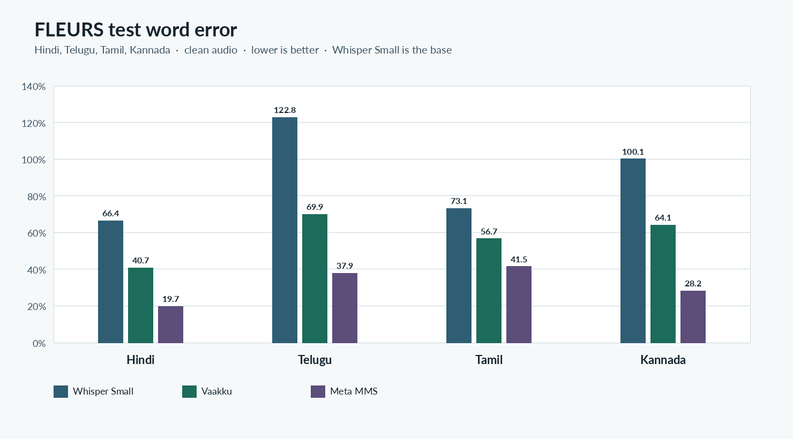
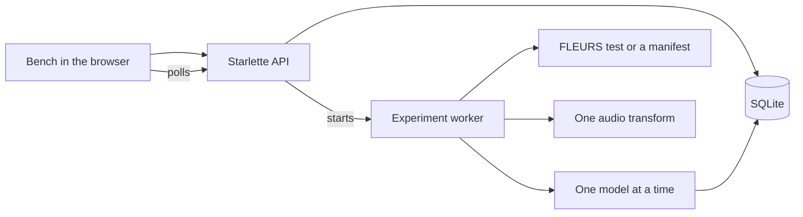

# Vaaku

Indic speech bench. The measured comparison below is Whisper Small, the Vaakku LoRA on that checkpoint, and Meta MMS on the same clips.

## Results

Official **FLEURS test**, clean audio, scored on an NVIDIA A10G. Languages are Hindi (418 clips), Telugu (472), Tamil (591), and Kannada (838). Malayalam was not run. Rates are micro-averaged inside each language. The mean is the unweighted average of the four languages. Lower is better.

Whisper Small (`openai/whisper-small`) is the base model. Vaakku is a LoRA on that checkpoint (`rudra11/vaakku-whisper-small`). Meta MMS (`facebook/mms-1b-all`) is a separate system. “Versus base” is the change from Whisper Small on the same clips. Percentage points are the absolute gap. The percent beside them is the relative reduction.



| Language | Clips | Model | WER | Versus base | CER | Versus base | Sentence error |
|---|---:|---|---:|---:|---:|---:|---:|
| Hindi | 418 | Whisper Small | 66.4% | base | 37.0% | base | 100% |
| Hindi | 418 | Vaakku | 40.7% | −25.6 pp, 38.6% lower | 17.3% | −19.7 pp, 53.3% lower | 100% |
| Hindi | 418 | Meta MMS | 19.7% | −46.7 pp, 70.3% lower | 6.8% | −30.3 pp, 81.7% lower | 96.9% |
| Telugu | 472 | Whisper Small | 122.8% | base | 113.2% | base | 100% |
| Telugu | 472 | Vaakku | 69.9% | −52.9 pp, 43.1% lower | 31.4% | −81.8 pp, 72.2% lower | 100% |
| Telugu | 472 | Meta MMS | 37.9% | −84.9 pp, 69.2% lower | 9.0% | −104.2 pp, 92.1% lower | 98.5% |
| Tamil | 591 | Whisper Small | 73.1% | base | 26.4% | base | 100% |
| Tamil | 591 | Vaakku | 56.7% | −16.4 pp, 22.4% lower | 16.7% | −9.7 pp, 36.7% lower | 99.8% |
| Tamil | 591 | Meta MMS | 41.5% | −31.6 pp, 43.2% lower | 11.5% | −14.9 pp, 56.4% lower | 99.5% |
| Kannada | 838 | Whisper Small | 100.1% | base | 100.2% | base | 100% |
| Kannada | 838 | Vaakku | 64.1% | −35.9 pp, 35.9% lower | 25.1% | −75.1 pp, 74.9% lower | 99.6% |
| Kannada | 838 | Meta MMS | 28.2% | −71.8 pp, 71.8% lower | 4.7% | −95.5 pp, 95.3% lower | 95.1% |
| Mean of four |  | Whisper Small | 90.6% | base | 69.2% | base | 100% |
| Mean of four |  | Vaakku | 57.9% | −32.7 pp, 36.1% lower | 22.6% | −46.6 pp, 67.3% lower | 99.9% |
| Mean of four |  | Meta MMS | 31.8% | −58.8 pp, 64.9% lower | 8.0% | −61.2 pp, 88.5% lower | 97.5% |

Word error can exceed 100% when substitutions, deletions, and insertions together outnumber the reference words. Sentence error is the share of clips that are not an exact match after normalization.

| Language | Words | Model | Substitutions | Deletions | Insertions | Real-time factor |
|---|---:|---|---:|---:|---:|---:|
| Hindi | 10,326 | Whisper Small | 4,975 | 743 | 1,135 | 0.108 |
| Hindi | 10,326 | Vaakku | 3,535 | 416 | 256 | 0.157 |
| Hindi | 10,326 | Meta MMS | 1,711 | 195 | 128 | 0.004 |
| Telugu | 7,894 | Whisper Small | 2,598 | 5,284 | 1,811 | 0.059 |
| Telugu | 7,894 | Vaakku | 3,840 | 1,486 | 191 | 0.013 |
| Telugu | 7,894 | Meta MMS | 2,505 | 316 | 169 | 0.002 |
| Tamil | 9,836 | Whisper Small | 5,626 | 522 | 1,040 | 0.013 |
| Tamil | 9,836 | Vaakku | 4,571 | 676 | 332 | 0.013 |
| Tamil | 9,836 | Meta MMS | 3,121 | 310 | 649 | 0.002 |
| Kannada | 13,310 | Whisper Small | 856 | 12,454 | 9 | 0.007 |
| Kannada | 13,310 | Vaakku | 5,786 | 2,355 | 394 | 0.010 |
| Kannada | 13,310 | Meta MMS | 2,963 | 490 | 306 | 0.001 |

Phone, date, name, address, and code-mix checks do not apply to these FLEURS clips. The exact rates are in `results/fleurs_test.csv`. Whisper Medium was not part of this run. IndicConformer is gated and was not scored.

The page is a small web app. It is not Streamlit.

## Architecture



The browser never loads a model. A run is a separate process, so the page stays usable. Status, predictions, and scores are in SQLite and survive a restart. Models are loaded one at a time and unloaded before the next one. If Whisper Medium does not fit in GPU memory, that model fails. It is not replaced by Whisper Small.

| Piece | Role |
|---|---|
| `web/` | The bench: room, run, scores, robustness, marks, tape, export |
| `app/server.py` | Token gate, JSON API, audio, downloads |
| `src/models/` | Whisper, IndicConformer, MMS |
| `src/datasets/` | FLEURS test, pipeline demo, custom manifest |
| `src/audio/` | Noise, speed, volume, reverb, MP3. Originals stay untouched |
| `src/evaluation/` | WER, CER, SER, edits, digits, code-mix |
| `src/experiments/` | Validation, worker, resume |
| `outputs/benchmark.db` | Runs and row-level results |

## What is scored

The headline set is the official **FLEURS test** split for Telugu, Tamil, Hindi, Kannada, and Malayalam. A run downloads only the number of rows you set.

Kathbath, IndicVoices, and Common Voice are listed and **not selectable**. Kathbath is reported training speech for Indic models. IndicVoices is gated and was used to train Indic ASR. Common Voice does not cover Telugu and Kannada evenly.

The English clips in `data/demo` only check that a run finishes. They are not an Indic score.

## Models

| Id | Checkpoint | Languages verified here |
|---|---|---|
| `whisper-small` | `openai/whisper-small` | te, ta, hi, kn, ml, plus en for the demo |
| `whisper-medium` | `openai/whisper-medium` | same as Small |
| `vaakku` | `rudra11/vaakku-whisper-small` on `openai/whisper-small` | te, ta, hi, kn, ml. Not English |
| `mms` | `facebook/mms-1b-all` | tel, tam, hin, kan, mal. CC-BY-NC weights |

`ai4bharat/indic-conformer-600m-multilingual` is gated and is not in this run. NVIDIA Canary and Parakeet checkpoints are public, and their language lists are European. They do not cover Telugu, Tamil, Hindi, Kannada, or Malayalam, so they are not selectable here.

Uploading a file to compare models is not implemented. The hook is `src/inference/upload.py`.

## Run it

```bash
python -m venv .venv
.venv/bin/python -m pip install torch torchaudio --index-url https://download.pytorch.org/whl/cpu
.venv/bin/python -m pip install -r requirements.txt
cp .env.example .env
bash scripts/run_server.sh
```

Open `http://127.0.0.1:8787`.

On the GPU box, install the CUDA wheel that matches the driver instead of the CPU wheel, keep `DASHBOARD_HOST=127.0.0.1`, and open it from your laptop with:

```bash
export AWS_HOST=... AWS_USER=ubuntu AWS_PEM_PATH=/path/to/key.pem
bash scripts/tunnel.sh
```

Then use `http://127.0.0.1:8787` on the laptop. The process on the box is not exposed to the public internet.

```bash
# on the box
bash scripts/run_server.sh            # start
pkill -f "uvicorn app.server:app"     # stop
bash scripts/run_server.sh            # start again
tail -f outputs/logs/*.log            # experiment logs
```

## Custom data

CSV header:

```text
sample_id,audio_path,reference,language,speaker_id
```

`audio_path` is relative to the audio directory you enter on the Run page. JSON can add `license`, `provenance`, and `entities`. See `data/examples/custom_manifest.example.csv`. When `speaker_id` is present, the subset takes one clip per speaker.

## Tests

```bash
.venv/bin/python -m pytest -q
.venv/bin/python -m ruff check src config app tests
```

CI does not download model weights or FLEURS.
